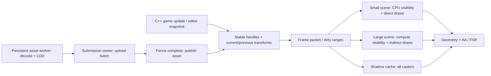

# Развитие runtime renderer

Реализованы runtime transforms, CPU/GPU visibility, геометрические LOD,
динамические солнечные тени и фоновая подготовка assets. Основа сравнения —
`f2d164f`. Целевая платформа и фактическая проверка — Windows x64,
C++23 / Vulkan 1.3, MSVC 14.38, RX 6800, Ryzen 7 9700X.

## Архитектура и границы владения



- `SceneDocument` остаётся редакторским документом. World matrices кешируются
  по local transform и revision родителя. Изменение материала не пересчитывает
  матрицы. Это не новый ECS и не skeletal-animation system.
- `RuntimeTransforms` содержит до 100 000 slots с index/generation. Game code
  вызывает `Renderer::set_runtime_transform()` на границе кадра. Единственный
  mutable owner — submission thread; worker не обращается к Vulkan или scene.
  Runtime API отклоняет non-finite, singular и reflected transforms: opaque
  pipelines используют фиксированный winding. Nonuniform scale и shear с
  положительным determinant поддерживаются.
- GPU record — 128 bytes: прежние 80 bytes current instance и 48 bytes previous
  transform. Cooked mesh/scene formats не менялись. Previous относится к последнему
  успешно отправленному submission, включая отдельный settling frame после
  прекращения движения. Structural/material edits сбрасывают FSR history.
- GPU path обновляет только dirty 128-byte records; каждый frame slot получает
  собственные накопленные изменения после своего fence. Полный upload нужен
  при смене scene/backend. CPU fallback компактизирует источник и видимые
  instances; при неизменном packet повторный upload отсутствует.
- Новые Vulkan objects используют `DeviceObject`/`GpuBuffer` RAII. Upload arena
  переиспользуется после batch fence. Shared LOD history и shadow map имеют
  явные межкадровые dependencies. Visibility statistics читаются после frame
  fence без дополнительного WAIT; они могут отставать на 1–2 submissions.

## Visibility и LOD

`auto` использует CPU для малых сцен и GPU от 1024 source records при наличии
`drawIndirectFirstInstance` и требуемых compute/storage limits. Недоступный GPU
path имеет CPU fallback; принудительный `gpu` сообщает понятную ошибку.
Миллион объектов в старом `instancing` benchmark остаётся отдельным прямым draw.

Для больших cube-only сцен `auto` дополнительно оценивает 64 samples при
изменении scene/view/settings. Если больше половины
выборки остаётся видимой, renderer использует прямой instanced draw всех
instances (`visibility_backend: direct`). Sparse updates при этом сохраняются.
Выборка влияет только на выбор стоимости пути: фактическое GPU culling всегда
проверяет все объекты, а direct path может лишь нарисовать лишние. Принудительный
`gpu` отключает эту эвристику для A/B. Граница подобрана для текущего workload;
она не гарантирует лучший путь на любой архитектуре GPU.

GPU compute параллельно проверяет AABB against frustum, occlusion grid и LOD,
компактизирует visible indices и записывает `VkDrawIndexedIndirectCommand`.
Обычно 128 threads одной workgroup резервируют диапазон одним atomic на LOD;
границы draw groups используют корректный общий путь. Не требуются subgroup
extensions, `multiDrawIndirect`, readback для visibility или новая queue.
При неизменных camera/scene/settings используются закешированные indirect
commands: compute pass тоже не выполняется заново.

Occlusion — консервативная сетка 32×18 по настоящим непрозрачным cubes.
Ячейка заполняется, только если все четыре угла с запасом попали внутрь
проекции convex occluder. Хранится самая дальняя глубина occluder, а culling
сравнивает ближайшую глубину объекта. Near-plane crossing, частичное покрытие
и отверстия сохраняют объекты. Пустая сетка отключает occlusion tests.
GPU path выбирает 16 occluders из bounded списка 64 кандидатов; CPU path
не применяет occlusion при менее 64 records. На CPU fallback без подходящего
GPU автоматический occlusion ограничен 2048 records; `--visibility-backend cpu`
позволяет явно измерить полный CPU путь.

Это не Hi-Z occlusion по всем мешам: imported models и terrain пока не служат
occluders. Они могут отсекаться, получать тени и отбрасывать тени. Сетка намеренно
недоотсекает; эффективность зависит от реальной сцены. GPU compacted draw order
не гарантирует определённый победивший fragment у совпадающих поверхностей.
Прозрачные sorted draws в этот opaque path добавлять нельзя.

Model LOD создаются библиотекой [meshoptimizer v0.25](https://github.com/zeux/meshoptimizer/tree/v0.25#simplification),
commit `6daea4695c48338363b08022d2fb15deaef6ac09`, MIT, лицензия в
`LICENSES/meshoptimizer.txt`. LOD0 сохранён; LOD1/2 целятся в 50%/25% индексов,
учитывают normals/UV и сохраняют границы. Не каждый mesh можно упростить до
целевого количества. Малые meshes не упрощаются. Общий vertex buffer сохраняется;
это уменьшение triangles, а не сжатие исходного vertex storage.

Выбор использует ошибку simplifier, консервативный масштаб transform, ближайшую
view depth AABB и perspective magnification, включая off-axis geometry. Бюджет
по умолчанию — 1 render pixel; coarsening требует запаса 20%, refinement
применяется сразу. Это оценка геометрической ошибки, не гарантия визуальной
идентичности текстур/бликов. Dithering/crossfade между LOD не реализован.
Terrain имеет index LOD с шагом 1/2/4 и измеренной ошибкой высоты; shadow pass
сохраняет LOD0. Terrain пока выбирает один LOD целиком, без quadtree/chunk seams.

## Тени и assets

Cubes, ground, models и terrain участвуют в shadow pass, включая объекты вне
основного view frustum. Static scene переиспользует карту; изменение runtime
transform или authored snapshot инвалидирует её. `average_gpu_shadow_ms`
отделён от geometry timing, неизменная карта даёт 0. Используется одна карта
2048×2048 и существующий фиксированный sun frustum ±48 world units, near/far
1/180. Это ещё не каскадные тени для большого мира. Любое движение caster пока
перерисовывает карту целиком; shadow culling/частичное обновление не реализованы.
`--dynamic-shadows off` оставляет прежние terrain-only shadows, а не отключает
всё освещение и все тени.

Один постоянный `std::jthread` подготавливает cooked mesh, LOD и textures.
Одновременно допускаются две jobs, включая готовые результаты. Idle polling
не берёт mutex. GPU creation, mapped copy и submit выполняет единственный
submission owner. Модель публикуется после fence одного общего upload batch;
на startup допускается ожидание вне измеряемого render loop. В editor
сохраняется одно pending добавление модели; смена сцены отменяет это добавление.

Upload arena ограничена 512 MiB на подготовленный asset, отдельный decode —
128 MiB, LOD index storage — 64 млн индексов. Request/model cache имеет лимит
1024, texture/material descriptors — 4096; GPU mesh/texture caches ограничены
каждый 2 GiB и живут до shutdown. Это ещё не texture streaming с eviction.
512 MiB — предел upload payload, а не пик суммарной CPU памяти worker/scratch.
Большой GPU allocation или copy готового asset всё ещё может дать разовый
frame hitch при публикации: полностью распределённая по бюджету кадров загрузка
не заявляется. Shader/pipeline variants подготавливаются на старте; background
shader hot-reload и общий job system для всех игровых систем не добавлены.

Для гарантированной ёмкости 100 000 source records frame buffers резервируются
заранее. Сумма размеров instance/visibility/upload/readback buffers — около
171 MiB, без textures, AA и прочих ресурсов; часть памяти размещается на host,
часть на device согласно VMA. Эти buffers выделяются и для маленькой authored
scene на GPU с поддержкой нового пути. Это явный обмен памяти на отсутствие
роста ёмкости в steady state, а не минимальный memory footprint.

## Запуск

Примеры с `tree_stump_01_4k` требуют локального игрового пакета: он исключён
из Git. Можно указать собственную модель относительно `assets/`;
см. [GAME_CONTENT.md](GAME_CONTENT.md).

```powershell
.\scripts\run_windows.cmd --culling occlusion --lod on --dynamic-shadows on
.\scripts\run_windows.cmd --scene-count 100000 --animate-camera --visibility-backend gpu
.\scripts\run_windows.cmd --scene-count 100000 --scene-walls off --animate-scene
.\scripts\run_windows.cmd --scene-count 1024 --scene-asset tree_stump_01_4k/tree_stump_01_4k.vcrasset.json --scene-scale .02 --camera-z 300
.\scripts\run_windows.cmd --stream-asset tree_stump_01_4k/tree_stump_01_4k.vcrasset.json
```

- `--culling none|frustum|occlusion`; `--lod on|off`; `--dynamic-shadows on|off`.
- `--visibility-backend auto|cpu|gpu` — явный A/B; small scene по умолчанию CPU.
- `--animate-scene` — rigid motion одного объекта; `--animate-camera` — движение камеры.
- `--scene-count 1..100000`, `--scene-walls on|off`, `--scene-scale .001..100`
  задают воспроизводимую stress scene. Масштаб нужен для source units модели.
- `--camera-z 0..400` задаёт начальную дистанцию. Обычное управление камерой сохранено.
- Editor `Render` panel: переключатели visibility/LOD/shadows, LOD error,
  backend и counters/timings. Benchmark JSON schema 2 расширена полями settings,
  source/visible/rejected/LOD counts, scene preparation и GPU pass timings.
  Counts относятся к последнему доступному кадру, timings — к измеренному интервалу.

## Проверки

- Debug/Release/ASan: CTest 5/5 в каждой конфигурации.
- Shader compile + `spirv-val`, Vulkan 1.3 / SPIR-V 1.5, включая изменённый ABI.
- Debug и ASan: по 12 startup/shutdown, 120 captures, четыре сценария:
  canonical, animated, 100 000 instances, streaming. Каждый проходит resize,
  IMMEDIATE/FIFO, off/SMAA/FSR, legacy instancing и compute workload.
  Ошибок validation/synchronization/ASan и live GPU allocations не обнаружено.
  После заключительных правок дополнительно повторён streaming scenario.
  Отдельно проверён переход auto direct → GPU после разворота камеры примерно
  на 180° в Debug и ASan; изображения совпали с CPU reference без culling.
- Editor startup/render/shutdown с synchronization validation прошёл.
- Для wall scene и open scene по три ракурса: CPU reference без culling,
  GPU frustum и GPU occlusion дали одинаковые PNG (18 images).
  Раздельно размещённые 1024 модели: CPU/GPU изображения одинаковы с LOD и без
  LOD (4 images). Это проверка конкретных ракурсов, не доказательство для всех сцен.
  Пересекающиеся source-scale модели показали 34–39 отличающихся pixels из
  230 400 и при выключенном LOD; такой draw order не используется как exact-image gate.
- CPU tests проверяют previous/settling/generation, dirty hierarchy/reparent,
  near-plane/partial/gap visibility, LOD hysteresis/projection, реальные индексные
  LOD и bounded worker startup/overflow/error/shutdown.
- Native clang-tidy и MSVC `/analyze:only` + Core Check запускались на восьми новых
  runtime translation units. Исправлены обнаруженные integer conversions и
  неоднозначные optional access. Оставшиеся generic bounds/style рекомендации
  разобраны вручную; это не нулевой warning count всего проекта. В индексных
  циклах соблюдены фиксированные bounds; raw arithmetic meshoptimizer ограничена
  проверенными ranges на границе C API. Suppressions не добавлялись.
- RGP/PIX/ETW hardware-counter capture и глобальный heap-allocation profiler
  не запускались. Отсутствие steady-state роста проверено структурой bounded
  storage и reuse; полное отсутствие allocations во всех зависимостях не измерено.
  WPR доступен, но текущий Windows token не elevated; RGP/xperf в проверенных
  стандартных расположениях не найдены. Device-loss fault injection не выполнен.
- Linux не собирался и не запускался согласно платформенной политике MVP.

Локальные raw logs/PNG находятся в `build/windows-{debug,asan}/evolution-20260911`
и `render-validation/<scenario>`; benchmark JSON — в release build tree.
Generated artifacts не входят в Git.

## Повторение gates и замеров

```powershell
.\scripts\build_windows.cmd Debug
.\scripts\build_windows.cmd Release
.\scripts\build_windows.cmd ASan
.\scripts\compile_shaders_windows.ps1
.\scripts\render_validation_windows.ps1 -ExePath C:/GDF/vk_test/build/windows-debug/bin/vulkan_cube.exe -Scenario stress
.\scripts\benchmark_evolution_windows.ps1 -Suite Visibility -OutputName visibility-check
.\scripts\benchmark_evolution_windows.ps1 -Suite Lod -ModelAsset tree_stump_01_4k/tree_stump_01_4k.vcrasset.json -OutputName lod-check
.\scripts\benchmark_evolution_windows.ps1 -Suite Shadows -OutputName shadows-check
.\scripts\benchmark_evolution_windows.ps1 -Suite Adaptive -OutputName adaptive-check
```

ASan executable запускается с MSVC x64 environment (vcvars64), как при сборке.
Analyzer targets `vcr_clang_tidy` и `vcr_msvc_analyze` opt-in, работают в
существующем Windows build tree. MSVC target также требует vcvars64.
Для узкой проверки: `scripts/analyze_windows.ps1 -Tool MSVC -Sources runtime_scene.cpp,scene_visibility.cpp`.

Performance suite использует Release, IMMEDIATE, 1920×1080, прогрев 5 s,
измерение 15 s, три чередующихся повторения. `Compatibility` требует старый
executable вместе с его shaders/SMAA assets/FSR DLL; `--dynamic-shadows off`
и остальные compat flags удерживают прежний набор технологий. Сравнивать старый
executable с новыми 128-byte shaders нельзя. Снимок GPU/driver/CPU/power scheme
и списка процессов записывается рядом с JSON. Clocks/temperature не фиксируются;
не запускать другие benchmarks, GPU tests или сборку одновременно.

Основа synchronization: [Khronos examples](https://docs.vulkan.org/guide/latest/synchronization_examples.html).
Optional indirect first instance проверяется по
[VkPhysicalDeviceFeatures](https://docs.vulkan.org/refpages/latest/refpages/source/VkPhysicalDeviceFeatures.html).

## Измеренные результаты, 2026-09-11

RX 6800, Ryzen 7 9700X, Windows driver 32.0.21045.5002, Vulkan driver 8388961,
Release, 1920×1080, фактический IMMEDIATE, validation off. Power plan —
«Сбалансированная», clocks/temperature не фиксировались. Ниже — медианы трёх
прогонов, в скобках min–max FPS; 1% low тоже медиана трёх значений. CPU frame
включает ожидания драйвера/present и не равен чистому CPU времени работы.

Совместимость с `f2d164f`: одинаковая исходная сцена, 139 533 triangles,
новые culling/LOD/authored shadows отключены с обеих сторон.

| AA | FPS до → после | Изменение | 1% low до → после | CPU frame, ms до → после | GPU frame, ms до → после |
|---|---:|---:|---:|---:|---:|
| Off | 2596,5 (2594,9–2646,4) → 2585,4 (2580,0–2680,9) | −0,43% | 1777,4 → 1796,3 | 0,3851 → 0,3868 | 0,1958 → 0,1978 |
| SMAA | 2479,3 (2474,2–2486,3) → 2479,8 (2473,5–2483,8) | +0,02% | 1772,5 → 1777,5 | 0,4033 → 0,4033 | 0,2239 → 0,2242 |
| FSR | 1238,6 (1236,2–1238,6) → 1237,3 (1233,7–1244,2) | −0,11% | 1023,0 → 1017,7 | 0,8074 → 0,8082 | 0,6154 → 0,6154 |

Измеренной существенной регрессии базового пути здесь нет. Финальная сборка
с новыми настройками по умолчанию, AA off: **2644,4 FPS** (2642,9–2662,5),
1% low 1802,4, CPU 0,3782 ms, GPU 0,1896 ms. Она рисует 119 009 triangles
(одна модель перешла на LOD1), поэтому её прирост нельзя приписать только
снижению overhead. Исторические ~2941 FPS при 1280×720 и 170 triangles —
другая сцена и разрешение, с этой таблицей напрямую не сравниваются.

| Workload / путь | FPS (min–max) | 1% low | CPU frame, ms | GPU frame, ms |
|---|---:|---:|---:|---:|
| 100k cubes, walls, direct без culling | 2169,2 (2167,8–2173,7) | 1637,1 | 0,4610 | 0,2767 |
| 100k cubes, walls, финальный auto/GPU occlusion | 2526,2 (2516,2–2526,6) | 1771,2 | 0,3959 | 0,2126 |
| 100k cubes, open, direct без culling | 2185,2 (2168,1–2187,4) | 1639,6 | 0,4576 | 0,2766 |
| 100k cubes, open, финальный auto/direct | 2187,1 (2168,1–2188,4) | 1646,0 | 0,4572 | 0,2767 |
| 1024 модели, LOD off | 378,9 (378,8–379,4) | 349,9 | 2,6394 | 2,4110 |
| 1024 модели, LOD on | 1163,4 (1161,5–1166,0) | 981,0 | 0,8595 | 0,6642 |
| 100k cubes, один движется, terrain-only shadows | 2496,8 (2496,0–2509,2) | 1761,5 | 0,4005 | 0,2169 |
| 100k cubes, один движется, все dynamic casters | 1887,7 (1880,8–1897,7) | 1446,4 | 0,5298 | 0,3464 |

Visibility сравнивается с движущейся камерой. Occlusion даёт **+16,5% FPS**
в wall scene; последний доступный кадр содержит 19 102 visible, 18 674 frustum
rejected, 62 224 occlusion rejected. Это счётчики кадра, не среднее за прогон.
GPU visibility pass занимает около 0,031 ms, CPU scene preparation — 0,033 ms.

Принудительный GPU frustum оказался невыгоден для дешёвых cubes: 1853 FPS
в wall scene и 1962 FPS в open scene. Это обнаруженная регрессия, из-за которой
добавлен adaptive direct path. После него open auto и direct различаются на
0,09%, меньше разброса прогонов. Эвристика добавляет около 0,0033 ms CPU
preparation при изменении камеры, но в этой сцене избавляет от compute/indirection.
Принудительный `gpu` остаётся диагностическим режимом и может быть медленнее.

LOD test использует раздельно размещённые stumps, scale 0,02, camera z=300,
frustum culling и неподвижную сцену. Все 1024 модели выбрали LOD2: количество
triangles снизилось с 42 031 105 до 10 506 241, FPS вырос **в 3,07 раза**.
Это выигрыш от уменьшения геометрии с заданным бюджетом ошибки, а не бесплатное
повышение скорости при абсолютно одинаковом изображении.

Динамические тени на 100k casters стоят **+0,1295 ms GPU frame и −24,4% FPS**.
Сам shadow pass вырос примерно с 0,0030 до 0,1384 ms. Это принятый измеренный
компромисс ради нового результата: все casters участвуют в карте, а любое
движение перерисовывает её целиком. На неподвижной сцене карта кешируется.
Следующий предметный шаг для больших движущихся сцен — отсечение casters
по light frustum и обновление карты по областям; каскады потребуют отдельного
бюджета качества и GPU времени.

CPU stages сохранены в JSON. Например, wall direct → auto: fence
0,0184 → 0,0173 ms; acquire 0,0183 → 0,0194; record 0,0126 → 0,0133;
submit 0,0229 → 0,0259; present 0,3653 → 0,2597. У базовой scene compat
основная часть CPU frame приходится на present (~0,292 ms из 0,387 ms).
Это указывает на существенный вклад presentation/driver pacing, но без ETW
и hardware counters не доказывает конкретный аппаратный bottleneck.

Полная серия compatibility/visibility/LOD/shadows лежит в
`build/windows-release/evolution-final-20260911`. После выявления цены
GPU frustum финальный adaptive/default/shadows повторён в
`build/windows-release/evolution-adaptive-20260911`; `summary.json` там объединяет
медианы обеих серий. Вторая серия проверяет изменённый выбор пути; первая —
не затронутые им compatibility и forced-GPU/LOD режимы. Wall direct reference
в таблице взят из первой серии, финальный auto — из второй; исходная серия
также дала 2535 FPS с принудительным GPU occlusion против 2169 direct.
Каждый каталог содержит JSON отдельных прогонов, stdout/stderr и снимок окружения.
Без фиксации частот это локальные результаты с указанным разбросом, а не
универсальная гарантия FPS для будущих технологий или другого GPU.

## Acceptance Criteria и Definition of Done

- Game C++ API изменяет объект без scene rebuild; motion history и shadow
  invalidation следуют реальному submission ownership.
- Есть CPU fallback и переключаемые GPU culling/LOD/shadow paths; сохранены AA,
  resize, legacy workloads и корректная resource retirement.
- Новые ресурсы ограничены по ёмкости; горячий путь переиспользует storage.
- Windows builds, CPU tests, shader validation, validation/ASan soak выполнены;
  ограничения analyzer/profile/визуальной проверки перечислены явно.
- Performance выводы основаны на сопоставимых прогонах; цена новых эффектов
  отделяется от overhead архитектуры. Универсальная гарантия неизменного FPS
  для будущих графических технологий не даётся.
